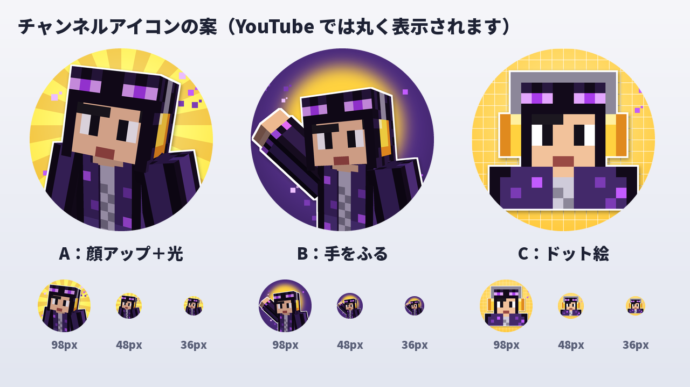

# せくぬゆ チャンネルアイコン

マイクラのスキン（エンダーパーカー＋黄色いヘッドセット）のキャラで作った、YouTube のチャンネルアイコンの案です。



## できあがったファイル（`output/`、どれも 800×800 の PNG）

| ファイル | 内容 |
| --- | --- |
| `icon_A.png` | A：顔アップ。黄色い光の筋の上で、首をかしげている |
| `icon_B.png` | B：手をふる。むらさきの背景に黄色い光の輪 |
| `icon_C.png` | C：ドット絵。スキンの顔をそのまま大きく。小さく表示しても一番はっきり見える |

- どの案も、キャラのまわりに白いフチを付けて、小さく表示しても形が分かるようにしています。
- まわりのむらさきの四角は、エンダーのつぶつぶです。
- YouTube では丸く切り取られるので、顔は真ん中の円に入れています。

## YouTube に設定する方法

1. YouTube Studio を開いて、左のメニューの「カスタマイズ」→「ブランディング」
2. 「写真」の「変更」（または「アップロード」）を押して、使いたい `icon_?.png` を選ぶ
3. 丸の位置を確認して「完了」→ 右上の「公開」

- おすすめの大きさは 800×800（最小 98×98）、ファイルは 4MB まで。どのファイルも 200KB くらいです。
- 画面の名前は変わることがあります。

## 作り直すとき

```sh
python3 make_icon.py   # output/icon_A.png〜icon_C.png と icon_options.png を書き出す
```

- キャラは `../sekunuyu-skin/sekunuyu_skin.png` から描いているので、スキンを変えたあとにもう一度実行すると、アイコンも新しいスキンになります。
- ポーズやカメラの位置は `make_icon.py` の `icon_a` / `icon_b`、ドット絵は `pixel_bust` で変えられます。
- 3D の描画にはサムネイルと同じレンダラー（`../sekunuyu-thumbnail/lib`）を使っています。絵はすべてオリジナルです。
