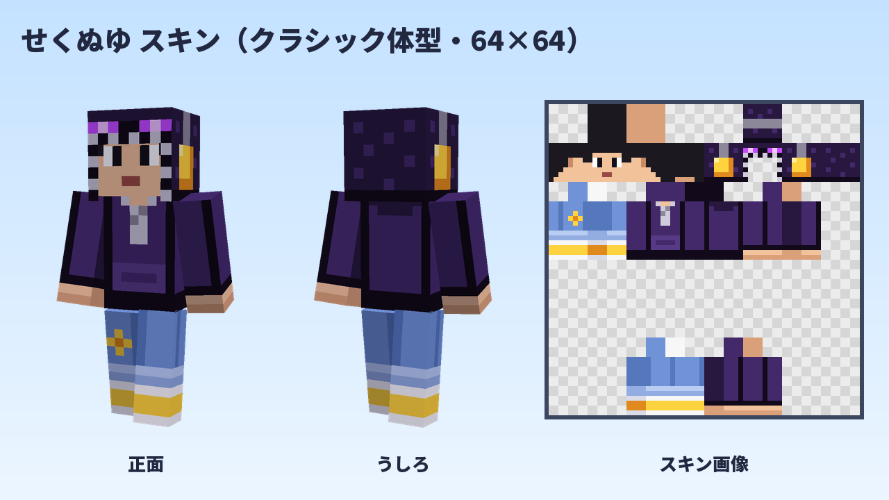

# せくぬゆ マイクラスキン

サムネイルのキャラ（黒髪・黄色いヘッドセット）が、エンダーマン風のパーカーを着たマインクラフト用スキンです。



## できあがったファイル

| ファイル | 内容 |
| --- | --- |
| `sekunuyu_skin.png` | ゲームに読み込むスキン画像（64×64、**クラシック体型**＝腕が太いほう） |
| `preview.png` | 着たときの見本（正面・うしろ・スキン画像） |

- 見た目：フードをかぶったむらさきのパーカー（フードの前にエンダーマンのような光る目、顔のまわりと胸にファスナー、おなかにポケット）、明るいデニムのロールアップ（右ひざにたんぽぽのワッペン）、白ソックス、黄色いスニーカー
- フードと、その上から付けた黄色いヘッドセットは、頭の2枚目のレイヤー（帽子レイヤー）に描いています。Java版で表示されないときは「設定」→「スキンのカスタマイズ」→「帽子」がオンになっているか確認してください。

## ゲームでスキンを変える方法

スキンを選ぶときに体型を聞かれたら、**クラシック**（腕が太いほう）を選んでください。
画面の名前はバージョンによって少し違うことがあります。

### Java版（パソコン）

1. Minecraft Launcher を開いて「Minecraft: Java Edition」を選ぶ
2. 「スキン」タブ →「新しいスキン」
3. 体型を「クラシック」にして、`sekunuyu_skin.png` を選ぶ
4. 「保存して使用」

ランチャーを使わずに、ブラウザで minecraft.net にログインして変えることもできます。

### 統合版（スマホ・Windows）

1. タイトル画面の「プロフィール」→「キャラクターを編集」
2. 左上の「クラシックスキン」のタブ →「所有済み」→「インポート」→「新しいスキンを選択」
3. `sekunuyu_skin.png` を選び、体型はクラシック（腕が太いほう）を選ぶ

Switch などのゲーム機版では、自分で作ったスキン画像は読み込めません。

## 作り直すとき

```sh
python3 make_skin.py   # sekunuyu_skin.png と preview.png を書き出す
```

- 服は `make_skin.py` の `OUTFIT` で選べます：`ender_hoodie`（エンダーパーカー、いまの設定）、`tee`（白T＋ヘッドセットとマイク、最初の服）
- ズボンは `PANTS_STYLE` で選べます：`rollup`（ロールアップ＋たんぽぽ、いまの設定）、`ender`（パーカーとおそろいのむらさき）、`gingham`（黄色のギンガムチェック）、`shorts`（ショートパンツ＋ボーダーソックス）、`jeans`（最初の濃いジーンズ）
- ドット絵は `make_skin.py` の中に、パーツ（頭・帽子レイヤー・体・腕・足）と面（正面・うしろ・横・上・下）ごとに文字で描いてあります。1文字が1ドットで、色は `PAL` で決めています（`.` は透明）。
- 見本の 3D 表示には、サムネイルと同じレンダラー（`../sekunuyu-thumbnail/lib`）を使っています。
- 絵はすべてこのスクリプトで描いたオリジナルです。
