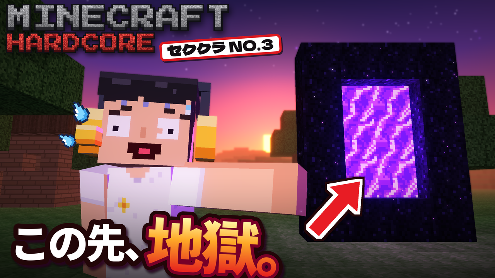
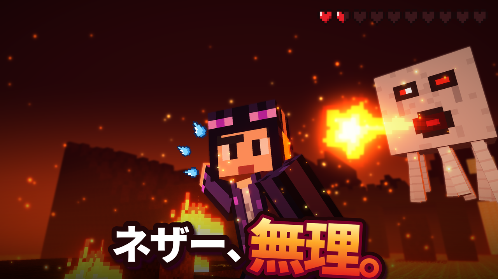

# せくぬゆ サムネイル（セククラ ハードコア）

YouTubeチャンネル「せくぬゆ」のマイクラ ハードコア実況シリーズのサムネイルです。

| #3（最初からネザーゲート造りまで） | #2（ネザー探検） |
| --- | --- |
|  |  |

## できあがったファイル（`output/`）

| ファイル | 内容 |
| --- | --- |
| `thumbnail_03.png` / `.jpg` | #3「この先、地獄。」（1280×720） |
| `thumbnail_02.png` / `.jpg` | #2「ネザー、無理。」（1280×720） |

JPG は約200KBで、YouTube の上限（2MB）に収まります。
YouTube Studio →「コンテンツ」→ 動画の「詳細」→「サムネイル」→「ファイルをアップロード」で設定できます。

## デザイン

### #3：この先、地獄。

クリックされやすさを優先した作り。

- **顔を大きく**：画面の主役はせくぬゆの顔。キャラはチャンネルのマイクラスキン（エンダーパーカー＋黄色いヘッドセット、`../sekunuyu-skin/sekunuyu_skin.png`）をそのまま着せて、アイコンやゲームの見た目とそろえている。汗で緊張感を出す
- **気になる一言**：「この先、地獄。」（#1「死んだら、終わり。」、#2「ネザー、無理。」と同じリズム）を一番大きく
- **見てほしい所をはっきり**：完成したネザーゲートを指さし、赤い矢印でも示す。紫に光るゲートと夕焼けの色の対比で目立たせる
- **要素をしぼる**：文字は「この先、地獄。」だけ。シリーズ名や番号は入れず、小さい画面でも顔・ゲート・文字がすぐ目に入るようにする
- 背景には最初に建てた家があり、「最初からゲートまで」の流れが伝わる

### #2：ネザー、無理。

- 文字は「ネザー、無理。」だけを真ん中下に大きく（#3 の「この先、地獄。」と同じ大きさ・色）。左上はロゴなどを入れられるようにあけてある
- せくぬゆ（チャンネルのマイクラスキン＝エンダーパーカー）が、ガストの火の玉からあわてて逃げている
- 体力ハート（右上）は残り1.5個で「大ピンチ」

## 作り直すとき

```sh
pip install -r requirements.txt   # Pillow / numpy / scipy
python3 make_thumbnail.py                       # 全エピソードを output/ に書き出し（1枚30〜40秒）
python3 make_thumbnail.py --episode 3           # #3 だけ
python3 make_thumbnail.py --episode 3 --preview # 等倍ですばやく確認（10秒くらい）
```

- 文字を変えたい：各エピソードのファイルの `TEXT`（例：`episodes/ep03_portal.py`）
- ポーズ・カメラ・ゲートや敵の位置：各エピソードの `Scene`
- キャラ：#2・#3 とも `../sekunuyu-skin/sekunuyu_skin.png` を読み込んで着せている。スキンを変えて作り直すと、サムネのキャラも変わる
- 新しい回を作るときは `episodes/` にファイルを足して、`make_thumbnail.py` の `EPISODES` に登録する
- フォントは初回実行時に Google Fonts から自動でダウンロードします。

| ファイル | 役割 |
| --- | --- |
| `make_thumbnail.py` | どの回を作るか選んで書き出す |
| `episodes/ep03_portal.py` | #3 のシーン（夕焼けとネザーゲート）と文字組み |
| `episodes/ep02_nether.py` | #2 のシーン（ネザーとガスト）と文字組み |
| `lib/voxel.py` | ブロックを描く小さな 3D レンダラー（Zバッファ、テクスチャ、ライト） |
| `lib/world3d.py` | 地形（ボクセル）から見える面だけを取り出す |
| `lib/models.py` | せくぬゆ（プレイヤー）とガストの 3D モデル、ポーズ |
| `lib/skin.py` | マイクラのスキン画像（64×64）を 3D モデル用に切り分ける |
| `lib/textures.py` | ブロック・ガスト・炎・ゲートのドット絵テクスチャ |
| `lib/post.py` | ぼかし・発光・被写界深度・色の仕上げ |
| `lib/overlay.py` | フチ取り文字、バッジ、矢印、ハート、汗、英字ロゴ（今のサムネでは未使用） |
| `lib/fonts.py` | フォントの自動ダウンロード |

## 素材について

- 絵はすべてこのスクリプトで描いたオリジナルです（ブロックの模様・キャラ・ガストもプログラムで作ったドット絵）。
- フォント：Noto Sans JP Black / Dela Gothic One（どちらも SIL Open Font License で、商用利用OK）
- 英字ロゴ（`lib/overlay.py` の `logo_title`）は、1マスずつ形を決めて描いたオリジナルの文字です（公式ロゴの画像やフォントは使っていません）。今のサムネでは使っていませんが、また使えるように残してあります。
